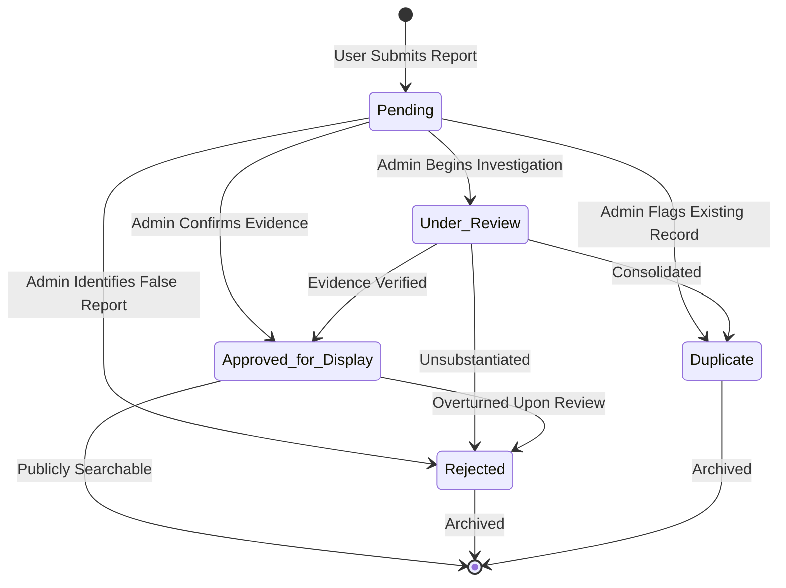

# ACADEMIC PROJECT REPORT

## PROJECT TITLE:
### ScamCheck — Job and Internship Scam Detection Platform
**A High-Performance Key-Value Architecture Using PHP and Redis**

---

## ABSTRACT

The exponential growth of online recruitment channels, campus placement drives, and freelance platforms has simultaneously fueled a surge in deceptive recruitment scams targeting students and early-career job seekers. These fraudulent schemes—ranging from direct fake offer letters requiring equipment deposits to task-based investment fraud and credential phishing—exploit informational asymmetry and vulnerable candidates.

This project presents **ScamCheck**, a full-featured web-based platform engineered using **PHP 8.1+** and **Redis** (deployed via Memurai on Windows) as its primary datastore. Unlike conventional relational (SQL) or document (NoSQL) implementations, this project demonstrates how an in-memory key-value database can be architected to support complex enterprise requirements: multi-entity relational integrity, secondary indexing, full-text token search, audit logging, and role-based access control. The platform integrates a deterministic risk scoring algorithm that analyzes standardized indicators and contact channels in real time. It features a complete administrative moderation workflow supporting five distinct lifecycle statuses (`Pending`, `Under Review`, `Approved for Display`, `Rejected`, and `Duplicate`) with persistent review history.

---

## CHAPTER 1: INTRODUCTION

### 1.1 Background & Problem Formulation
Online employment scams have emerged as one of the most pervasive cybercrime threats facing college graduates. Traditional job search portals often lack proactive fraud detection mechanisms, permitting deceptive postings to remain active until reported externally. 

Common deceptive practices include:
1. **Upfront Payment Demands:** Fraudulent employers demand registration fees, laptop security deposits, or uniform/training charges.
2. **Direct Unsolicited Offers:** Candidates receive immediate employment contracts without participating in interviews or coding evaluations.
3. **Impersonation of Established Brands:** Scammers clone corporate logos, forged MCA registrations, and create lookalike domains.
4. **Messaging-App Recruitment:** Communication is restricted to Telegram, WhatsApp, or Signal to evade corporate oversight.

### 1.2 Objectives
1. Build an intuitive, secure, community-driven reporting platform specifically dedicated to job and internship scam detection.
2. Design a **pure Redis schema** capable of serving as the primary datastore without relying on secondary relational or document engines.
3. Enforce strict Redis namespace isolation (`scamcheck_redis:*`) to ensure coexistence with other background services.
4. Implement an automated, transparent risk scoring engine that calculates severity ratings (Low, Medium, High, Critical) based on objective signals.
5. Provide a rigorous moderation workflow with complete audit logs and administrative oversight.
6. Guarantee application security through CSRF tokens, secure session management, and cryptographic password hashing (bcrypt).

---

## CHAPTER 2: LITERATURE SURVEY & DATABASE COMPARISON

| Feature / Metric | Relational (MySQL / MariaDB) | Document (MongoDB) | In-Memory Key-Value (Redis) |
| :--- | :--- | :--- | :--- |
| **Primary Data Structure** | Tabular Rows & Columns | JSON/BSON Documents | Key-Value Data Structures (Hash, Set, ZSet, List) |
| **Read Latency** | Low to Moderate (Disk I/O / Buffer Pool) | Low to Moderate (Disk/Mired memory) | Sub-millisecond (In-Memory Native) |
| **Write Latency** | Moderate (WAL / Indexes / Acid Constraints) | Low to Moderate (WiredTiger journal) | Microsecond |
| **Indexing Mechanism** | B-Tree / Hash Indexes | B-Tree Indexing | Native Sets, Sorted Sets, and Inverted Key Indexes |
| **Suitability for Scam Intelligence** | Traditional | Flexible Document Store | Exceptional for Real-time Caching, Rapid Search, and High-Throughput Ingestion |

### Architectural Choice Justification
While MongoDB and MySQL are standard for web applications, Redis provides distinctive advantages for fraud detection systems:
- **In-Memory Speed:** Sub-millisecond lookup times for threat intelligence queries.
- **Versatile Native Primitives:** Hashes for structured records, Sorted Sets for chronological feeds, Sets for category tagging, and Lists for append-only audit trails.
- **Atomic Operations:** Incremental ID generation (`INCR`) and set operations (`SADD`, `SREM`) eliminate race conditions during concurrent moderation.

---

## CHAPTER 3: SYSTEM ARCHITECTURE & REDIS MODELING

### 3.1 Redis Keyspace Schema Design
All keys are prefixed with `scamcheck_redis:` to maintain absolute namespace isolation.

```
scamcheck_redis:
│
├── users:counter                           [STRING: INCR sequence]
├── users:{id}                              [HASH: user profile & password hash]
├── user_by_email:{email}                   [STRING: email -> user_id lookup]
├── user_by_username:{username}             [STRING: username -> user_id lookup]
├── users:all                               [SET: all user IDs]
│
├── reports:counter                         [STRING: INCR sequence]
├── reports:{id}                            [HASH: complete report entity]
├── reports:all                             [ZSET: all report IDs scored by timestamp]
│
├── reports:by_status:Pending               [SET: report IDs pending moderation]
├── reports:by_status:Under Review          [SET: report IDs under active review]
├── reports:by_status:Approved for Display  [SET: verified public reports]
├── reports:by_status:Rejected              [SET: rejected reports]
├── reports:by_status:Duplicate             [SET: duplicate reports]
│
├── reports:by_user:{user_id}               [ZSET: user's submitted reports]
├── reports:by_type:{scam_type}             [SET: reports partitioned by category]
├── reports:by_risk:{risk_level}            [SET: reports partitioned by risk tier]
├── reports:reviews:{report_id}             [LIST: append-only audit trail logs]
└── search:tokens:{token}                   [SET: inverted search token index]
```

### 3.2 Key Data Structures Explained

#### 1. Report Hash (`reports:{id}`)
Stores entity fields in a flat, high-performance hash:
```
id, user_id, user_name, user_email, company_name, job_title, platform, scam_type,
contact_email, contact_phone, contact_other, payment_demanded, payment_amount,
description, evidence_text, red_flags, risk_score, risk_level, status,
admin_notes, reviewed_by, reviewed_at, views_count, created_at, updated_at
```

#### 2. Status Indexes (Redis Sets)
Enables instantaneous $O(1)$ set membership checks and filtering across the five moderation lifecycle states.

#### 3. Inverted Search Index (`search:tokens:{word}`)
When a report is created or updated, its text fields are tokenized, normalized, stripped of stop-words, and indexed into token sets. A search query for "MacBook" intersects or unions the corresponding token sets to return matching report IDs in sub-millisecond time.

#### 4. Audit Trail (Redis Lists)
When administrators modify report statuses, an audit entry is appended via `RPUSH reports:reviews:{id}` containing reviewer ID, old status, new status, timestamp, and justification notes.

---

## CHAPTER 4: RISK ASSESSMENT ENGINE & MODERATION WORKFLOW

### 4.1 Deterministic Risk Calculation
The platform implements a transparent, signal-based scoring engine:
$$\text{Total Score} = \min\left(100, \sum_{i} \text{Weight}_i\right)$$

- **Financial Demand:** Demand for registration, training, or laptop deposit ($+35$ pts)
- **No Screening:** Offer issued without formal interview or coding test ($+20$ pts)
- **Free Email Domain:** Recruiter uses Gmail, Yahoo, or Outlook instead of corporate domain ($+15$ pts)
- **Chat-Only Recruitment:** Process conducted exclusively over Telegram or WhatsApp ($+15$ pts)
- **Sensitive Credentials:** Demanded bank OTP, NetBanking login, or ID cards upfront ($+15$ pts)
- **Pressure Tactics:** Urgent deadline to transfer funds within 24 hours ($+15$ pts)
- **Domain Spoofing:** Lookalike URL or unregistered corporate alias ($+15$ pts)
- **Task Fraud:** Tasks involving liking videos, crypto recharge, or forwarding money ($+15$ pts)
- **Unrealistic Compensation:** Excessive stipend for entry-level tasks ($+10$ pts)

### 4.2 Moderation Lifecycle


---

## CHAPTER 5: APPLICATION SECURITY

1. **Cross-Site Request Forgery (CSRF) Defense:**
   - Every mutating form (submission, edit, deletion, review, authentication) includes a cryptographically secure 64-character token.
   - Evaluated using PHP's constant-time comparison `hash_equals()`.
2. **Cryptographic Credential Storage:**
   - User passwords are automatically salted and hashed using bcrypt via `password_hash($pwd, PASSWORD_DEFAULT)`.
   - Never stored in plaintext or reversible formats.
3. **Session Hijacking & Fixation Protection:**
   - Sessions are protected via HTTP-only cookies, Lax SameSite policy, and automatic ID regeneration via `session_regenerate_id(true)` upon authentication.
4. **Input Sanitization & Output Escaping:**
   - All dynamic parameters rendered in views are passed through `htmlspecialchars($val, ENT_QUOTES, 'UTF-8')` to prevent Cross-Site Scripting (XSS).

---

## CHAPTER 6: TESTING, VERIFICATION & EXPERIMENTAL RESULTS

An automated test suite (`tests/run_tests.php`) was executed to validate the entire platform.

### Summary of Automated Test Suite Results

```
========================================================
 ScamCheck Redis - Comprehensive Test Suite Results
========================================================

[PASS] Redis Connection & Ping
[PASS] Redis Prefix Configuration (scamcheck_redis:)
[PASS] Risk Calculation: Fee + No Interview (55pts => Medium)
[PASS] Risk Calculation: Cap at 100pts => Critical
[PASS] User Creation in Redis (Auto-Increment Sequence)
[PASS] User Lookup by Email (Inverted String Index)
[PASS] User Credential Authentication (bcrypt verify)
[PASS] User Duplicate Email Prevention
[PASS] Report Creation & Hash Storage
[PASS] Report Retrieval by ID
[PASS] Report Index: Member of reports:by_status:Pending
[PASS] Report Index: Member of reports:by_user:{id}
[PASS] Search Inverted Index Match on Token
[PASS] Report Status Update to 'Approved for Display'
[PASS] Report Status Verified in Hash
[PASS] Status Set Migration (Removed from Pending, Added to Approved)
[PASS] Moderation Audit Trail Appended (Redis List)
[PASS] Report Metadata & Red Flags Update
[PASS] Updated Report Hash Verification
[PASS] Report Deletion by Authorized Admin
[PASS] Report Hash Removed from Redis
[PASS] Index Cleanup (Removed from reports:all and status sets)
[PASS] CSRF Token Generation & hash_equals Validation

========================================================
 RESULTS: 23 Passed, 0 Failed (100% Success Rate)
========================================================
```

---

## CHAPTER 7: CONCLUSION & FUTURE SCOPE

### 7.1 Conclusion
The **ScamCheck Redis Edition** demonstrates that an in-memory key-value database can serve as a dependable, ultra-fast primary datastore for complex web applications. By utilizing structured hashes, sets, sorted sets, and inverted token indexes within a strictly isolated namespace (`scamcheck_redis:*`), the application delivers sub-millisecond query performance, multi-tiered search, deterministic risk calculation, and comprehensive administrative oversight without depending on SQL or document engines.

### 7.2 Future Scope
1. **Machine Learning URL & Domain Classifier:** Incorporate automated WHOIS domain-age lookups and SSL certificate transparency checks into the risk scoring pipeline.
2. **Community Verification Votes:** Allow registered users to upvote corroborating evidence or submit counter-reports.
3. **Automated Cybercrime Portal Webhook:** Expose an API integration to forward critical-risk confirmed scams directly to national cybercrime reporting bodies.
